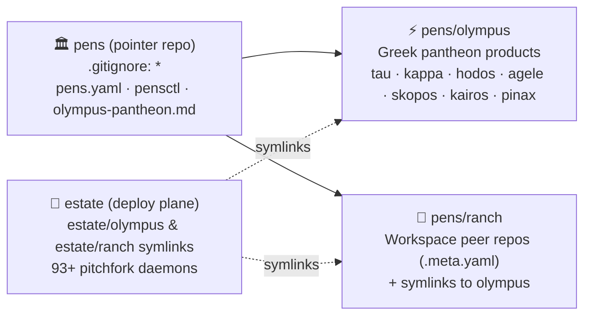

<div align="center">

[](https://github.com/toxicwind/pens)
[](https://github.com/toxicwind/estate)
[](https://github.com/toxicwind/estate/blob/main/LICENSE)

# 🏛️ pens — Local Code Organization Pointer Superproject

**Where the estate's code physically lives (`olympus`, `ranch`, `archive`) — tracked as a lightweight pointer manifest (`*` in `.gitignore`, zero submodules, never a monorepo).**

</div>

## Why `pens`?

The estate separates **where code is organized (`pens/`)** from **where daemons are deployed (`estate/`)**:

- **`pens/` (`toxicwind/pens`)** is a **pointer superproject**: `.gitignore` starts with `*` so every pen directory (`olympus/`, `ranch/`, `archive/`) is git-ignored here. Only the manifest and generator (`pens.yaml`, `pensctl`, `olympus-pantheon.md`, `README.md`, `.gitignore`) are tracked.
- **`olympus/` (`pens/olympus`)** is the **Greek pantheon pen**: holds all Greek-coded products (`tau`, `kappa`, `skopos`, `kilo`, `muse`, `keryx`, `hodos`, `kairos`, `kryptos`, `agele` [ex-`herd`], `pinax`, `agon`, `antilogos`, `pylae`, `propylon`, `opsis`, `didymos`, `chronos-forge`).
- **`ranch/` (`pens/ranch`)** is the **workspace pen**: peer repositories managed via `.meta.yaml` + `.meta-themes.yaml`, with additive symlinks (`ranch/<greek> -> /home/toxic/pens/olympus/products/<greek>`) so deploy-plane paths stay 100% compatible.
- **`estate/` (`toxicwind/estate`)** is the **deploy plane**: symlinks `estate/ranch -> /home/toxic/pens/ranch` and `estate/olympus -> /home/toxic/pens/olympus`, supervising 93+ daemons via `pitchfork`.

## Architecture



## Quick Start

```bash
# List all pens and their status
/home/toxic/pens/pensctl list

# Regenerate .gitignore (*), pens.yaml, and olympus-pantheon.md from live state
/home/toxic/pens/pensctl generate-all

# Verify pointer repo health (only manifest files tracked, zero submodules)
/home/toxic/pens/pensctl doctor
```

## Orthogonal Tool Layers

| Layer | Tool | Role |
|---|---|---|
| **Registry** | `pens.yaml` (`pens`) / `.meta.yaml` (`ranch`) | WHICH repos & pens exist |
| **VCS** | `jj` (colocated) + `git` | HOW history is tracked per peer repo |
| **Runtime** | `mise` (`mise.toml`) | WHICH toolchains execute |
| **Build** | `moon` (`moon.yml`) + `forge` | HOW components build & cache |
| **Deploy** | `pitchfork` (`estate/pitchfork.d/`) | WHERE services run & health-check |

## License & Security

Distributed under the **MIT License**. Because `.gitignore` enforces `*` at the root, no component source code, build artifacts, or secrets can ever be staged into `toxicwind/pens`.
